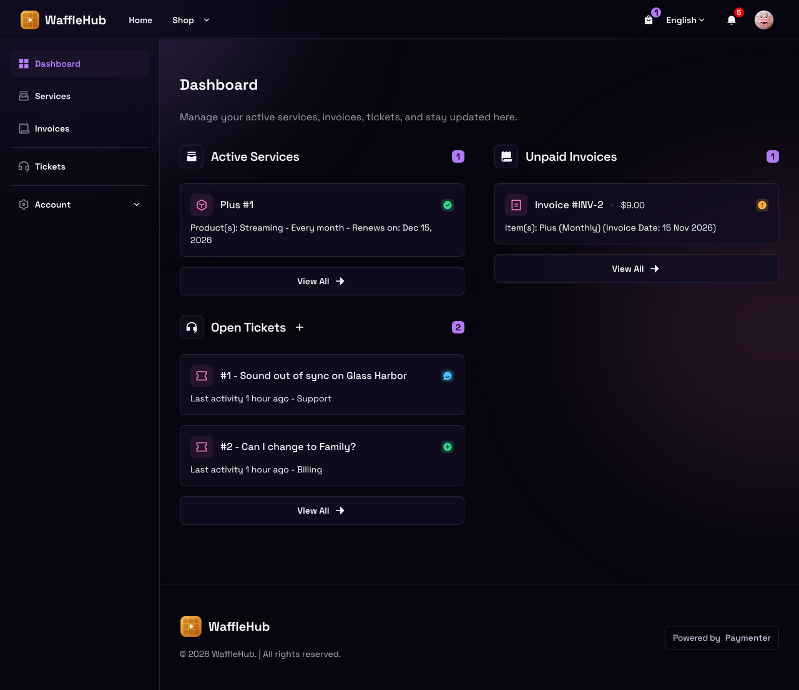

# WaffleHub, a theme for Paymenter

A dark, streaming-style theme for Paymenter: a wall of movie posters on the
front page, frosted-glass panels, and a soft violet-to-pink accent. With the
WaffleHub waffle logo.


<details>
<summary>Sign in, dashboard and mobile</summary>





</details>

> The screenshots are from a running Paymenter v1.5.9 with sample data.

## What the theme changes

The theme builds on Paymenter's default theme. Every page that is not in
`themes/wafflehub/views` comes from the default theme, so the cart, checkout,
client area and invoices work as before and keep up when Paymenter is updated.
They get WaffleHub's look from the stylesheet.

| Changed | How |
|---|---|
| Colours | Dark only (no light mode, no switch). One accent pair, violet to pink, and a soft light behind the pages |
| Font | Space Grotesk, served from your own server (no Google Fonts) |
| Front page | The headline over a wall of tilted posters that drift slowly; "How to get started" in three steps; subscriptions as cards |
| Posters | Drawn in the theme's colours (six motifs, no images to load), or your own images, see *Customising* |
| Sign-in pages | Sign in, sign up and password reset as a glass card over the poster wall |
| Product page | The product on the left, the price and "Add to cart" in a card on the right (below on a phone) |
| Panels | Every card, menu and box is frosted glass; the top bar has a thin accent line |
| Buttons | The accent gradient with a soft shadow; input fields light up in the accent colour |
| Logo and favicon | The waffle logo is used until you upload your own under Settings |
| Motion | The posters and the light move slowly. It can be turned off, and it is always off for visitors who ask their device for less motion |
| Footer | Tidied up. The "Powered by Paymenter" link is kept, as Paymenter asks |
| Register page | Has an extra hook (`auth.register`) so the [Paywarr extension](https://github.com/Lolles1911/paywarr) can show "Create an account with Discord" |
| Closed shop | When Paywarr's "Only Discord members can see the shop" is on, the subscriptions are hidden on the home page and the button leads to login/Discord |
| Languages | The theme's texts follow the language Paymenter shows: English and Danish included |

## Installation (LXC or a regular install)

The repo is private, so cloning asks for a GitHub token as the password
(GitHub → Settings → Developer settings → Fine-grained tokens, only
*Contents: Read* on this repo).

```bash
git clone https://github.com/Lolles1911/paymenter-theme-wafflehub.git /tmp/wafflehub     # or: cd /tmp/wafflehub && git pull
bash /tmp/wafflehub/install.sh /opt/paymenter
```

Then select the theme: **Admin → Settings → Theme → `wafflehub` → Save**.

The script copies two folders into Paymenter:

- `themes/wafflehub`: templates, colours and font
- `public/wafflehub`: the prebuilt stylesheet

You don't need Node or `npm` on the server.

## Customising

Under **Admin → Settings → Theme**, with WaffleHub selected:

- **Home page texts:** small label, heading, body text (Markdown) and button
  text. **Leave a field empty** to get the default text in the visitor's
  language; anything you type is shown as it is, in every language. If the
  shop's name appears in the heading, it gets the accent gradient.
- **Poster wall images:** one image address per line, e.g. posters you have
  uploaded somewhere or from your media server. Empty = the drawn posters.
  Images on another site are loaded from that site by every visitor.
- **"How to get started"** can be turned off.
- **Moving light in the background:** turns the drifting posters and light off.
- **Colours:** the accent (Primary to Secondary), text, borders and
  backgrounds. "Reset Colors" puts them back to WaffleHub's colours.
- **Logo and favicon** are uploaded under Settings → General as usual.

**Upgrading from the earlier, caramel WaffleHub:** the texts you saved are
kept. Colours saved for the caramel version are not used (the new colour
settings have other names), so the new look shows right away. The caramel
version is still in the repo's history (commit `8c10916`).

## Languages

The theme's own texts (home page, the three steps, the closed-shop button) are
in `themes/wafflehub/lang/<language>/home.php`: `en` and `da` are included.
The theme registers them itself and picks the one matching the visitor's language
(the language switch, otherwise **Admin → Settings → General → Default
Language**); languages without a file get English. To add one, copy `lang/en`
to e.g. `lang/de` and translate the texts on the right. Paymenter's own texts
(menu, cart and so on) come from Paymenter.

**Upgrading from a version with Danish texts in the settings:** earlier
versions filled the home page fields with Danish text. Saved fields keep
winning, so empty them under **Admin → Settings → Theme** to get the
translated texts.

## If you change the stylesheet or the templates

The stylesheet is prebuilt against Paymenter **v1.5.9**. If you add new
Tailwind classes, or run another Paymenter version and something looks wrong,
rebuild it on the server (requires Node 22):

```bash
cd /opt/paymenter && npm install && npm run build wafflehub
```

## Known caveats

- The theme uses the default theme's JavaScript build (`public/default`). It is
  there in a normal install; the script stops if it is missing.

## Files

| File | Contents |
|---|---|
| `themes/wafflehub/theme.php` | Name, colours and front page settings |
| `themes/wafflehub/css/app.css` | Stylesheet: the default theme + WaffleHub |
| `themes/wafflehub/views/home.blade.php` | The front page |
| `themes/wafflehub/lang/` | The theme's texts in English (`en`) and Danish (`da`) |
| `themes/wafflehub/views/layouts/` | Layout (loads the files, the light behind the pages, the poster wall on the sign-in pages) and colour variables |
| `themes/wafflehub/views/components/` | Logo, waffle mark, poster wall and posters, button, footer, editor, (empty) light/dark switch |
| `themes/wafflehub/views/auth/register.blade.php` | The register page with the hook for the Discord button |
| `themes/wafflehub/views/products/show.blade.php` | The product page: the product and its price as two cards |
| `themes/wafflehub/fonts/` | Space Grotesk (SIL Open Font License) |
| `public/wafflehub/` | The prebuilt stylesheet and font |
| `install.sh` | Copies the theme into Paymenter |
